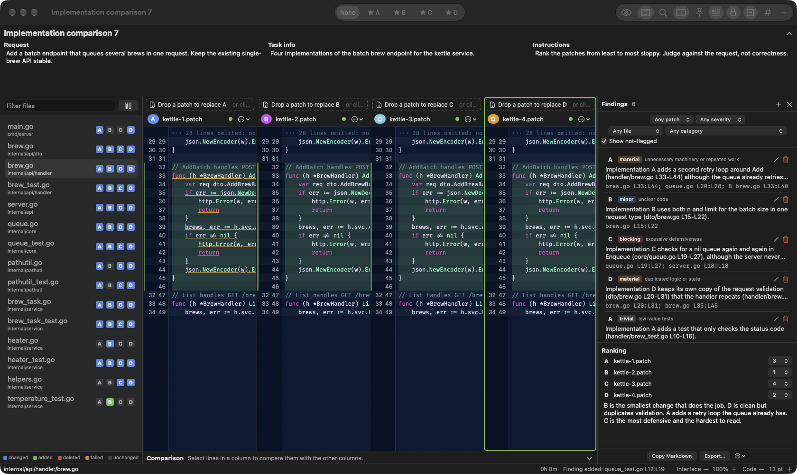
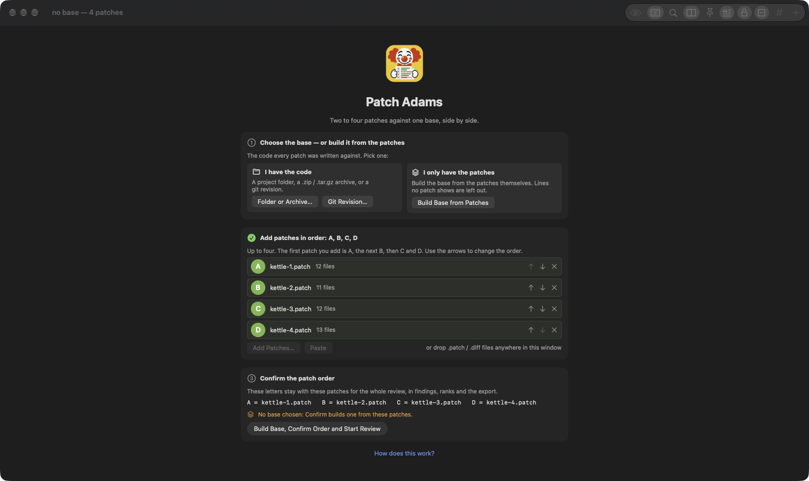
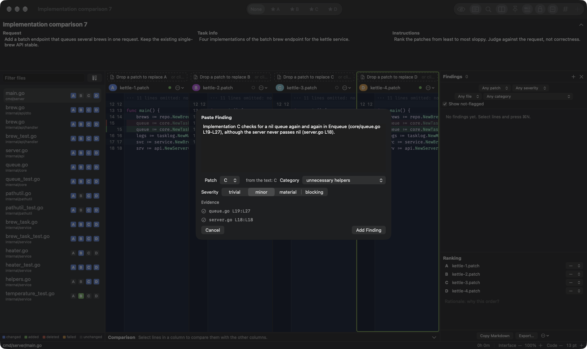
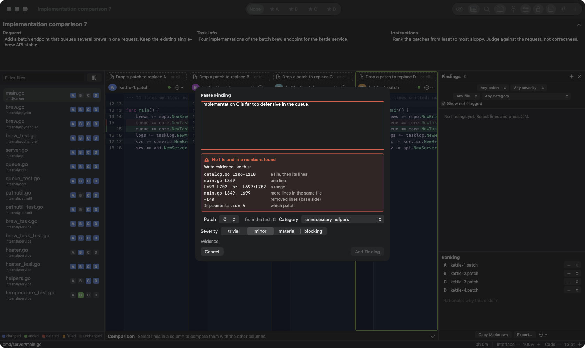
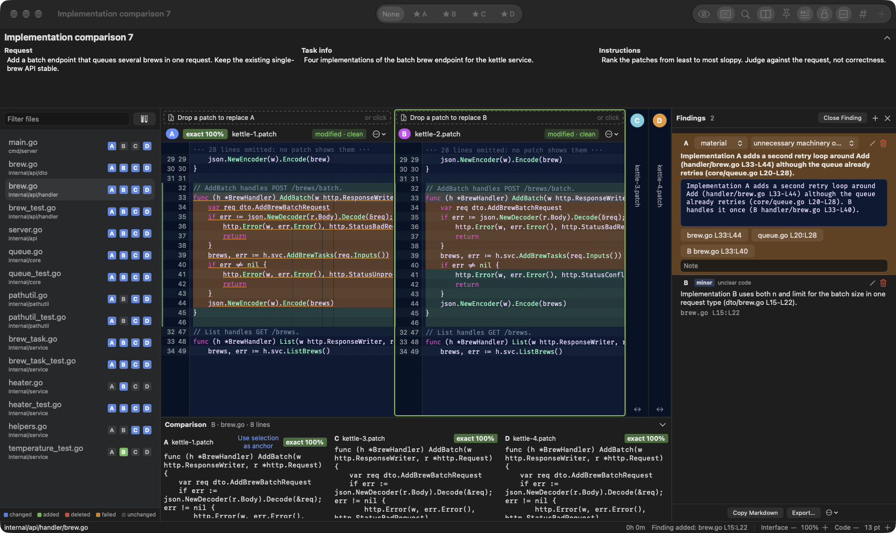
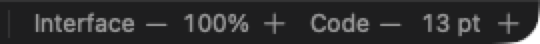

# Patch Adams

A native macOS app for comparing two to four patches against one code
base, side by side, so a reviewer can pick the best patch for a pull
request and write down why.

Each patch gets a column. Select some lines in one column, and the app
finds the same code in the others and tells you how it compares:
`exact`, `modified`, `moved`, or `absent`. Make any column the
*golden* patch and read the others as diffs against it. Record findings
as you go; each one carries a reference such as `main.rs L94:L101`,
generated from your selection, never typed. You can also paste a
finding as text: the app reads references like `catalog.go L106-L110`
out of it and marks those lines. Export the review as Markdown, ready
to paste into a review form, or as JSON for tools.

The name is a pun on Patch Adams, the clown doctor.



*Four implementations of one task, side by side. The task header holds
the title, the request, task info and instructions; the file tree shows
which patches touch each file; findings and the ranking sit on the
right. All screenshots use the invented kettle-service demo.*

- [Install](#install)
- [Quick start](#quick-start)
- [The window](#the-window)
- [Reviewing](#reviewing)
- [Sessions and export](#sessions-and-export)
- [Keyboard](#keyboard)
- [Settings](#settings)
- [Build from source](#build-from-source)
- [Project layout](#project-layout)
- [Further documentation](#further-documentation)

## Install

Requires macOS 14 or later.

Download the DMG, open it, and drag **Patch Adams** to Applications.
To build the DMG yourself, see [Build from source](#build-from-source).

`git` is optional. With it, the app can read a base straight from a
git revision. Without it, directory and archive bases still work; the
welcome screen shows which you have.

## Quick start

The first time, a short guide walks through these steps; *How does
this work?* on the opening screen brings it back.

1. **Choose the base**, the code the patches were made against: a
   directory, a `.tar` / `.tar.gz` / `.zip` archive, or a git revision.
   **Only have the patches?** Click *Build Base from Patches*, or skip
   it: step 3 builds one for you. Every line any patch shows is used;
   the rest is left out.
2. **Add two to four patches**: drop `.patch` or `.diff` files on the
   window, click *Add Patches…*, or paste a diff with ⌘⌥V. They fill
   the slots **A, B, C, D** in order; the arrows change the order.
3. **Confirm the order.** The screen lists `A = …  B = …`; the letters
   stay with those patches for the whole review. Press *Confirm Order
   and Start Review*.
4. **Fill in the task**: its title (e.g. *Implementation comparison
   103*), the request — the task prompt findings are judged against —
   and, if you like, task info and instructions.
5. **Pick a file** in the tree on the left. It opens in every column.



*The opening screen. Pick real code or build the base from the patches;
the patches fill A, B, C, D in order; the review starts once you confirm
which letter is which patch.*

The app asks once whether to review blind (see [Blind mode](#blind-mode)).

## The window

| Zone | What it does |
|---|---|
| Task header | The task title, then three boxes: *Request* (the task the patches answer), *Task info* and *Instructions*. ⌘R folds it to the title alone. |
| File tree | Every file any patch touches, with one status chip per patch: changed, added, deleted, unchanged, or failed to apply. Filter box; *Tests Only* (⌘⌥T). |
| Columns | One per patch. The header shows the label (A–D) **and** the patch file name, so a label can never be confused with the wrong file. Above each header, a slot: drop a patch file on it, or click it, to replace that column's patch. With fewer than four patches, a thin column with an add icon sits to the right: click it or drop a patch on it. Every other line has a faint green band, like greenbar paper. |
| Gutter | Two line numbers per line, at the code's size: base on the left, post-patch on the right. Removed lines show inline, struck through; ⌘⌥− hides them. |
| Comparison panel | Below the columns. For the selected lines, one pane per other column with a word-level diff against the located lines. |
| Findings sidebar | On the right, a quarter of the window: the findings list with filters, the ranking, and the export buttons. |
| Status bar | The current file, golden-mode diff counts, blind mode, the session timer, and two − / + pairs: **Interface** scale and **Code** size. |

A file that fails to apply stays visible as its raw hunks with a
warning. Files over 50,000 lines open in a reduced, hunks-only mode.

## Reviewing

The app is built around the order a careful comparative review takes:
read the request, scan the tree, review one file at a time across all
columns, pick a provisional golden patch, record findings as you see
them, and rank last.

### Comparing a region

Select lines in any column. Every other column marks where that code
landed:

| Badge | Meaning |
|---|---|
| `exact` | The same text at the same place. |
| `modified` | The same place, different text. The percentage is the token similarity. |
| `moved` | The same text somewhere else in the file. |
| `absent` | No match above 60% similarity. A dashed red notice links to the patch's nearest hunk. |

When the selection declares something (a function, type, struct or
const), the app looks for the same name first; a name match outranks a
position match. Click a badge to make the located lines the new
selection and compare back the other way.

If the app picked the wrong lines, select the right ones in that column
and click *Use selection as anchor* in its comparison pane. The
correction is saved with the session and wins on reload.

### Golden patch

Set a column golden with ⇧⌘1–4, the toolbar picker, or the column
menu. Every other column then shows its diff against the golden
column's text instead of against the base, and the status bar counts
the files and lines that differ. Press the same keys again to clear it.

### Search, pins, scroll lock

- **Search** (⌘F) finds text in every file of every column, grouped by
  file, then column, each hit with its reference.
- **Pin** (⌘P) keeps a selection in the pins sidebar to come back to.
- **Scroll lock** (⌘L) keeps every column on the same base line.
- `]` and `[` jump to the next or previous hunk in the focused column.

### Findings

Select lines and press ⌘N. The sheet is prefilled with the column, the
file and the reference. Fill in:

- **Title**, **category** and **severity** (trivial, minor, material,
  blocking): required. Categories start from a list of common patch
  problems (unnecessary helpers, excessive defensiveness, dead or
  unrelated code, and so on) and you can add your own.
- **Does the request ask for this?** yes, no, or unclear.
- **Description**, and a **note** for a correctness worry you want to
  park. Severity is about quality, not correctness.
- **Not flagged**: tick it to record that you considered something and
  passed. It shows in the export under its own heading.

### Pasting a finding

Click **+** in the findings sidebar and paste a finding you wrote
elsewhere. Pick the category and severity; the app finds the evidence
in the text:

| Write | Means |
|---|---|
| `catalog.go L106-L110` | a file, then its lines (`L106:L110` and `L 106` work too) |
| `main.go L349, L699-L702` | more lines in the same file, until the next file name |
| `-L40` | removed lines, by base line number |
| `Implementation A` | the finding's patch (also *Patch*, *Column*, *Version* …) |
| `(B main.go L640)` | evidence in another patch, to compare implementations |



*Pasting a finding. "Implementation C" picks the patch; each reference
gets a ✓ once its lines are found in that patch.*

Text with no usable evidence turns red, with a guide under it, and
*Add Finding* stays off until a reference lands.



*No file and line numbers in the text: the box turns red and shows how
to write evidence.*

### Working with a finding

Click a finding in the sidebar:

- Its lines turn **amber** in the code, in every patch it cites.
- The patches it does not cite fold to thin strips, so its patch takes
  the width; click a strip to open that patch, or *Close Finding* to
  bring everything back.
- It opens in place, at the code's text size: edit the title, text,
  category, severity and note directly. If you change a line number in
  the text, the highlight follows.
- Its references are buttons: each jumps to those lines and opens the
  patch they are in, folding any other.
- ✏️ opens the full editor; 🗑 deletes it, after asking.



*A finding in focus. Its lines are amber; it cites patch B too, so A and
B stand side by side while C and D fold away. The buttons under its
text — `brew.go L33:L44`, `queue.go L20:L28`, `B brew.go L33:L40` —
jump to each piece of evidence. The comparison panel shows where the
same code landed in every other patch.*

Findings mark their lines in the column, coloured by severity. `}` and
`{` walk the focused column's findings; clicking one in the sidebar
jumps every column there. Right-click a finding for *Same Issue In* to
copy it to another column at the matching lines, *Copy Finding*, or
*Mark as Not Flagged*.

### Ranking

In the findings sidebar, give each patch a rank from 1 to 4 (ties are
allowed) and write the rationale.

### Blind mode

⌘⌥B shows the patches as shuffled numbers and hides their file names,
to reduce order bias. The shuffle is seeded and saved, so a session
reopens to the same numbers. The export reveals which number was which
patch only in its last section.

## Sessions and export

- **Save** (⌘S, ⇧⌘S for Save As) writes one `.patchadam` file holding
  the session and every patch, so it can be mailed or archived and
  reopened with nothing else. The base is kept as a pointer, not a
  copy. Columns, golden choice, the task header, findings, pins,
  ranking, manual anchors and blind mode all come back on **Open
  Session** (⌘⌥O). If the base has moved, the app rebuilds one from the
  patches and says so. Sessions saved as folders by 1.0 still open.
- **Export Markdown** (⌘E) writes the review write-up: the request
  (collapsed), a ranking table, findings grouped by patch in rank order,
  the not-flagged passes, and the rationale. ⌘⌥E copies it instead.
- **Export JSON** (⇧⌘E) writes the same record with every finding's
  anchors and confidence scores, for tooling.
- **Copy Reference** (⇧⌘C) copies `filename Lstart:Lend` for the
  selection. A selection of removed lines only gives `filename -Lstart:Lend`
  in base line numbers.

The app never runs, builds or tests the patched code, and never uses
the network. Nothing you load leaves the machine.

## Keyboard

| Keys | Action |
|---|---|
| ⌘1 – ⌘4 | Focus column 1–4 |
| ⇧⌘1 – ⇧⌘4 | Set column 1–4 golden; again to clear |
| ⌘N | New finding from the selection |
| `}` / `{` | Next / previous finding in the focused column |
| `]` / `[` | Next / previous hunk in the focused column |
| ⌘F | Search all columns |
| ⌘P | Pin the selection |
| ⌘L | Scroll lock |
| ⌘= / ⌘− / ⌘0 | Bigger / smaller / actual size code text (content scale) |
| ⌥⌘= / ⌥⌘− / ⌥⌘0 | Bigger / smaller / actual size interface |
| ⌘R | Task header |
| ⌘⌥B | Blind mode |
| ⇧⌘C | Copy reference |
| ⌘S / ⇧⌘S | Save session / Save As |
| ⌘⌥O | Open session |
| ⌘E / ⇧⌘E / ⌘⌥E | Export Markdown / Export JSON / Copy Markdown |
| ⇧⌘N | New session |
| ⌘O / ⇧⌘O / ⌘⌥V | Open base / Add patches / Paste patch |

## Settings

⌘, opens Settings: the **interface scale** (80–200%: every panel,
header and footer — larger for a 5K display, smaller for a laptop),
the code font (any fixed-pitch family) and size (9–24 pt; default
system monospace at 12 pt), and whether to ask about blind mode on a
new session. Both scales also sit in the status bar and the View menu.



*The two scales in the status bar. Click the number to go back to
100% or 12 pt.*

Code is coloured by language, picked from the file extension (Go, Rust,
Python, Swift, Zig, JavaScript and TypeScript, C and C++, shell, YAML,
TOML, JSON, Markdown, CSS). The colours are the Spacetrucker Galactic
palette: neon magenta keywords, cyan types, phosphor-green function
names, peach strings, sunset-orange numbers and steel-blue comments, on
deep Prussian blue in dark mode, and darker shades of the same hues in
light mode. The added and removed backgrounds stay on top.

## Build from source

Requires Xcode 16 or later (Swift 6) and
[XcodeGen](https://github.com/yonaskolb/XcodeGen) for the app. The
engines build with `swift` alone and have no third-party dependencies.

```
git clone git@github.com:SpaceTrucker2196/PatchAdams.git
cd PatchAdams
make test      # engine tests: swift test --enable-code-coverage
make build     # the app: xcodegen + xcodebuild, warnings are errors
make harness   # parse every fixture patch and apply it to its base
make dmg       # a Release build in a DMG (ad-hoc signed by default)
```

The debug app lands at
`.build/DerivedData/Build/Products/Debug/PatchAdams.app`. To try it
without your own patches, use **Debug → Open Demo Session** (⌘⌥D):
four Go patches on a base rebuilt from them.

Pushing a tag with "Release" in its name builds the DMG on GitHub and
attaches it to that release:

```
git tag v0.6.0-Release
git push origin v0.6.0-Release
```

A notarized DMG needs a *Developer ID Application* certificate:

```
make dmg notarize SIGN='Developer ID Application: river.io llc (U3Z59VXPUB)'
```

`patchadam`, the command-line harness, runs the engines without the
app:

```
swift run patchadam parse  Fixtures/patches/old-fixture-8.patch
swift run patchadam hunks  Fixtures/patches/old-fixture-8.patch
swift run patchadam apply  Fixtures/bases/old-fixture-8 Fixtures/patches/old-fixture-8.patch
swift run patchadam diff   old.txt new.txt
```

## Project layout

```
Design/              the app icon: owner artwork and the 1024 px icon cut from it
App/                 SwiftUI shell over AppKit text views (project.yml → PatchAdams.xcodeproj)
Sources/
  PatchModel/        strict unified-diff parser
  BaseLoader/        read-only base: directory, archive, git revision
  ApplyEngine/       in-memory apply with fuzz, line maps, references
  DiffEngine/        Myers and patience line diff, token diff
  AlignmentEngine/   locate a region in another column; golden rendering
  SessionModel/      findings, ranking, session package, Markdown and JSON export
  SyntaxHighlight/   per-language token scanner for syntax colour
  patchadam/         command-line harness
Tests/               one XCTest target per engine
Fixtures/patches/    10 invented fixture patches (tools/fixtures/make_fixtures.py); Fixtures/bases/ their rebuilt bases
```

Engines never import SwiftUI or AppKit, so `swift test` checks all of
them without the app. The app shell owns the session state and never
calls an engine directly.

## Further documentation

| Document | What is in it |
|---|---|
| [`docs/spec.md`](docs/spec.md) | The product spec: requirements FR-1 to FR-35, architecture, the alignment algorithm |
| [`MISSION.md`](MISSION.md) | Charter and the invariants the app must keep |
| [`ROADMAP.md`](ROADMAP.md) | Milestones M0–M5 and the gates each one passed |
| [`FACTORY.md`](FACTORY.md) | Build and release runbook, and driving the app from a shell |
| [`DECISIONS.md`](DECISIONS.md) | Decisions and refusals, with the reasons |
| [`AGENTS.md`](AGENTS.md) | Rules for coding agents working in this repo |
| [`docs/dark-factory.md`](docs/dark-factory.md) | How the repo runs: production orders as issues, `/converge`, the autonomy contract |
| [`wiki/`](wiki/README.md) | Research notes, published with GitHub Pages |
